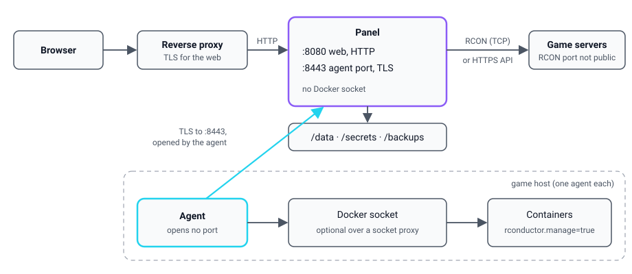

<p align="center">
  <a href="https://github.com/NightDragon1/rconductor/actions/workflows/ci.yml?query=branch%3Amain"></a>
  <a href="https://github.com/NightDragon1/rconductor/releases/latest"></a>
  <a href="https://hub.docker.com/r/nightdragon1/rconductor-panel"></a>
  <a href="https://hub.docker.com/r/nightdragon1/rconductor-agent"></a>
  <a href="LICENSE"></a>
  
</p>

<p align="center">
  <picture>
    <source media="(prefers-color-scheme: dark)" srcset="assets/logo/rconductor-logo-dark.svg">
    
  </picture>
</p>

# ShadowGhost.NET Game RCONductor

RCONductor is a self-hosted web panel for RCON-capable game servers with
fine-grained roles and permissions. Containers are controlled only by a small
agent per game host; the panel never touches the Docker socket.

Run it only in your LAN or behind a VPN. The web port speaks plain HTTP; TLS
is the job of a reverse proxy. Never publish the RCON port of a game server.

<p align="center">
  
</p>

## Quick start

Images: `docker.io/nightdragon1/rconductor-panel` and `rconductor-agent`, for amd64
and arm64. The same images are on ghcr.io: use `ghcr.io/nightdragon1/` instead.
Use the exact version such as `1.2`, or `1` for the newest 1.x.

### How to run – A: docker run

Panel:

```sh
docker network create rconductor
docker run -d --name rconductor-panel --network rconductor --restart unless-stopped \
  --read-only --cap-drop ALL --security-opt no-new-privileges:true \
  --memory 1g --pids-limit 256 \
  -p 8080:8080 -e RCD_AGENT_PUBLIC_ADDR=rconductor-panel:8443 \
  -v rconductor-data:/data -v rconductor-secrets:/secrets -v rconductor-backups:/backups \
  docker.io/nightdragon1/rconductor-panel:1.2
until docker logs rconductor-panel 2>&1 | grep password:; do sleep 1; done
```

Agent, with the pairing token from the panel (see first steps):

```sh
docker run -d --name rconductor-agent --network rconductor --restart unless-stopped \
  --read-only --cap-drop ALL --security-opt no-new-privileges:true \
  --memory 1g --pids-limit 256 \
  --group-add "$(stat -c %g /var/run/docker.sock)" \
  -e RCD_PAIRING_TOKEN=rcd1.... \
  -v /var/run/docker.sock:/var/run/docker.sock -v rconductor-agent-secrets:/secrets \
  docker.io/nightdragon1/rconductor-agent:1.2
```

The agent runs as a non-root user and reaches the Docker socket through the
socket's group (`--group-add`). The memory limit also sets the panel's Go
memory limit; raise it together with `RCD_MAX_CONNECTIONS`.

### How to run – B: Docker Compose

`compose.yaml`:

```yaml
services:
  panel:
    image: ${RCD_IMAGE_REPO:-docker.io/nightdragon1}/rconductor-panel:1.2
    restart: unless-stopped
    read_only: true
    mem_limit: 1g
    pids_limit: 256
    cap_drop: [ALL]
    security_opt: ["no-new-privileges:true"]
    ports:
      - "8080:8080"
    environment:
      # Agents reach the panel over the Compose network; 8443 stays unpublished.
      RCD_AGENT_PUBLIC_ADDR: panel:8443
      RCD_IMAGE_REPO: "${RCD_IMAGE_REPO:-docker.io/nightdragon1}"
    volumes:
      - data:/data
      - secrets:/secrets
      - backups:/backups
  agent:
    image: ${RCD_IMAGE_REPO:-docker.io/nightdragon1}/rconductor-agent:1.2
    restart: unless-stopped
    read_only: true
    mem_limit: 1g
    pids_limit: 256
    cap_drop: [ALL]
    security_opt: ["no-new-privileges:true"]
    group_add: ["${DOCKER_GID:-999}"]
    environment:
      RCD_PAIRING_TOKEN: "${RCD_PAIRING_TOKEN:-}"
    volumes:
      - /var/run/docker.sock:/var/run/docker.sock
      - agent-secrets:/secrets
volumes:
  data:
  secrets:
  backups:
  agent-secrets:
```

```sh
echo "DOCKER_GID=$(stat -c %g /var/run/docker.sock)" > .env
docker compose up -d
until docker compose logs panel | grep password:; do sleep 1; done
echo 'RCD_PAIRING_TOKEN=rcd1....' >> .env    # token from the panel, see first steps
docker compose up -d agent
```

Ready-made Compose files for panel and agent on separate hosts, or both on
one, are in [deploy/compose](https://github.com/NightDragon1/rconductor/tree/main/deploy/compose) (`panel.yaml`, `agent.yaml`,
`all-in-one.yaml`).

### First steps

1. Open `http://<host>:8080`, sign in as `admin` with the password from the log and set a new one.
2. Under **Agents**, **Pair an agent**, **Make token**; give the token to the agent and start it.
3. Give your game containers the label `rconductor.manage=true`; the agent manages only those.
4. Under **Servers**, tab **Manage servers and server groups**, **New server**: name, game profile, host, RCON port and password.

## Important variables

### Panel

| Variable | Default | Purpose |
| --- | --- | --- |
| `RCD_AGENT_PUBLIC_ADDR` | empty | `host:port` under which agents reach the panel's agent port 8443 |
| `RCD_PUBLIC_URL` | empty | public URL of the panel, such as `https://rcon.example.org`, behind a reverse proxy |
| `RCD_TRUSTED_PROXIES` | empty | addresses of your reverse proxy; only from those `X-Forwarded-For` and `X-Forwarded-Proto` count |
| `RCD_IMAGE_REPO` | `docker.io/nightdragon1` | registry the pairing dialog names and, in the Compose example, of the images; `ghcr.io/nightdragon1` selects ghcr.io |

### Agent

| Variable | Default | Purpose |
| --- | --- | --- |
| `DOCKER_GID` | `999` | group of `/var/run/docker.sock` in the Compose file; lets the agent reach the socket |
| `RCD_PAIRING_TOKEN` | empty | pairing token, made in the panel; ignored after the pairing |
| `RCD_PANEL_ADDR` | empty | `host:port` of the panel's agent port, for pairing by fingerprint or to override the token's address |
| `RCD_AGENT_NAME` | host name | name shown in the panel |
| `RCD_HOST_IP` | empty | address of the game host the RCON admin sees |
| `RCD_DOCKER_HOST` | `unix:///var/run/docker.sock` | Docker API, also a socket proxy such as `tcp://socket-proxy:2375` |

All variables and settings: [configuration](docs/user/configuration.md).

## Links

- Documentation: [docs/user](docs/user), and the [changelog](CHANGELOG.md).
- Wiki with examples (reverse proxy, agent on another host, supported games): [wiki](https://github.com/NightDragon1/rconductor/wiki).

## Development

Requirements: Go (see `go.mod`), Node.js 22 or newer, Docker with buildx.

| Command | Does |
| --- | --- |
| `make web` | install UI dependencies and build the UI into `internal/webui/dist` |
| `make build` | static binaries `bin/panel` and `bin/agent` (CGO off) |
| `make test` | Go unit tests |
| `make images` | local images `rconductor-panel:dev` and `rconductor-agent:dev` |
| `make test-integration` | build the images and run the integration tests against them |
| `MINECRAFT_ACCEPT_EULA=true make test-minecraft` | walking skeleton against a real Minecraft server (see below) |
| `make test-e2e` | build the UI and run the Playwright tests against a test panel (`internal/e2e/stack`) |
| `make lint`, `make vuln` | golangci-lint and govulncheck |
| `make generate` | regenerate sqlc and oapi-codegen code |
| `cd web && npm run lint && npm run format:check && npm test` | UI checks |

`api/openapi.yaml` is the single source of the API: server stubs are
generated with oapi-codegen, UI types with `npm run gen:api`. Without a UI
build the panel answers 503 on UI pages.

`make test-minecraft` downloads the pinned Minecraft server JAR into
`.cache/minecraft` (checked against its SHA-1) and runs it in a Java
container. Running a Minecraft server means accepting the
[Minecraft EULA](https://aka.ms/MinecraftEULA). The script and the test
refuse to run until you accept it by setting `MINECRAFT_ACCEPT_EULA=true`;
only then is `eula=true` written for the server. CI sets the variable for
its Minecraft job.

## License

RCONductor is free software, licensed under the
[GNU Affero General Public License v3.0 or later](LICENSE)
(SPDX: `AGPL-3.0-or-later`). Game profiles in `profiles/` are part of the
repository and covered by the same license.
