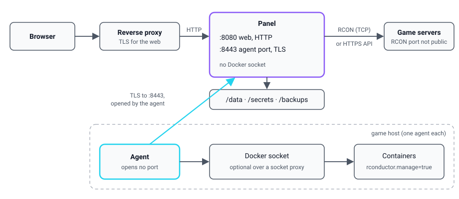

# RCONductor agent

[](https://github.com/NightDragon1/rconductor/actions/workflows/ci.yml?query=branch%3Amain)
[](https://github.com/NightDragon1/rconductor/releases/latest)
[](https://github.com/NightDragon1/rconductor/blob/main/LICENSE)


The agent of RCONductor, the self-hosted web panel for RCON-capable game
servers (image `nightdragon1/rconductor-panel`). One agent runs on each game
host: it reads the Docker socket, reports the containers labelled
`rconductor.manage=true` with state, logs and usage to the panel, and starts,
stops or restarts them on the panel's order. It opens no port; it connects
out to the panel's agent port over TLS with pinned keys.

> **Status: pre-release.** Versions below 1.0 (tags `0.x`) are test
> versions with known issues. They are **not ready for production use**.
> There is no `latest` tag yet; the stable tag `1` follows with 1.0.

Run the panel only in your LAN or behind a VPN, and never publish the RCON
port of a game server. The agent needs the Docker socket; give it only to
this container.



Tags: `1` (newest 1.x) and the exact version such as `{version}`. Use the same
major version as the panel, and update the panel first.

## Quick start

Make the pairing token in the panel under **Agents** → **Pair an agent** →
**Make token**. Until it has a token the agent waits and says so in its log.
The image is also on ghcr.io: use `ghcr.io/nightdragon1/` instead of
`docker.io/nightdragon1/`.

### How to run – A: docker run

```sh
docker run -d --name rconductor-agent --restart unless-stopped \
  --read-only --cap-drop ALL --security-opt no-new-privileges:true \
  --group-add "$(stat -c %g /var/run/docker.sock)" \
  -e RCD_PAIRING_TOKEN=rcd1.... \
  -v /var/run/docker.sock:/var/run/docker.sock -v rconductor-agent-secrets:/secrets \
  docker.io/nightdragon1/rconductor-agent:{version}
```

### How to run – B: Docker Compose

`compose.yaml`:

```yaml
services:
  agent:
    image: docker.io/nightdragon1/rconductor-agent:{version}
    restart: unless-stopped
    read_only: true
    cap_drop: [ALL]
    security_opt: ["no-new-privileges:true"]
    group_add: ["${DOCKER_GID:-999}"]
    environment:
      RCD_PAIRING_TOKEN: "${RCD_PAIRING_TOKEN:-}"
    volumes:
      - /var/run/docker.sock:/var/run/docker.sock
      - agent-secrets:/secrets
volumes:
  agent-secrets:
```

```sh
echo "DOCKER_GID=$(stat -c %g /var/run/docker.sock)" > .env
echo 'RCD_PAIRING_TOKEN=rcd1....' >> .env
docker compose up -d
```

### First steps

1. Make the token in the panel and start the agent with it.
2. Give your game containers the label `rconductor.manage=true`.
3. In the panel, give a server its agent and container.

For panel and agent on one host, see the panel image.

## Important variables

| Variable | Default | Purpose |
| --- | --- | --- |
| `DOCKER_GID` | `999` | group of `/var/run/docker.sock` in the Compose file; lets the agent reach the socket |
| `RCD_PAIRING_TOKEN` | empty | pairing token, made in the panel; ignored after the pairing |
| `RCD_PANEL_ADDR` | empty | `host:port` of the panel's agent port, for pairing by fingerprint or to override the token's address |
| `RCD_AGENT_NAME` | host name | name shown in the panel |
| `RCD_HOST_IP` | empty | address of the game host the RCON admin sees |
| `RCD_DOCKER_HOST` | `unix:///var/run/docker.sock` | Docker API, also a socket proxy such as `tcp://socket-proxy:2375` |

All variables: https://github.com/NightDragon1/rconductor/blob/main/docs/user/configuration.md

## Links

- Source and known issues: https://github.com/NightDragon1/rconductor
- Agent on another host, with pairing by fingerprint: https://github.com/NightDragon1/rconductor/wiki/Agent-on-another-host
- Wiki with examples: https://github.com/NightDragon1/rconductor/wiki
- Releases: https://github.com/NightDragon1/rconductor/releases
