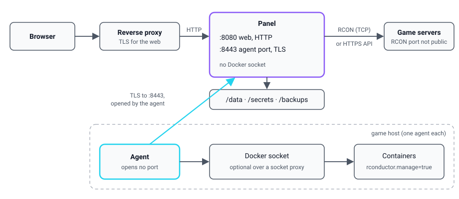

# RCONductor panel

Self-hosted web panel for RCON-capable game servers, with roles and
permissions. Containers are controlled by a small agent per game host
(image `nightdragon1/rconductor-agent`); the panel never touches the Docker
socket.

> **Status: pre-release.** Versions below 1.0 (tags `0.x`) are test
> versions with known issues. They are **not ready for production use**.
> There is no `latest` tag yet; the stable tag `1` follows with 1.0.

<!-- security note of README.md -->

Tags: `1` (newest 1.x) and the exact version such as `{version}`. There is no `latest`; use `:1`.

<!-- quick start of README.md -->

<!-- important variables of README.md -->

## Links

- Source and known issues: https://github.com/NightDragon1/rconductor
- Documentation: https://github.com/NightDragon1/rconductor/tree/main/docs/user
- Wiki with examples: https://github.com/NightDragon1/rconductor/wiki
- Releases: https://github.com/NightDragon1/rconductor/releases
